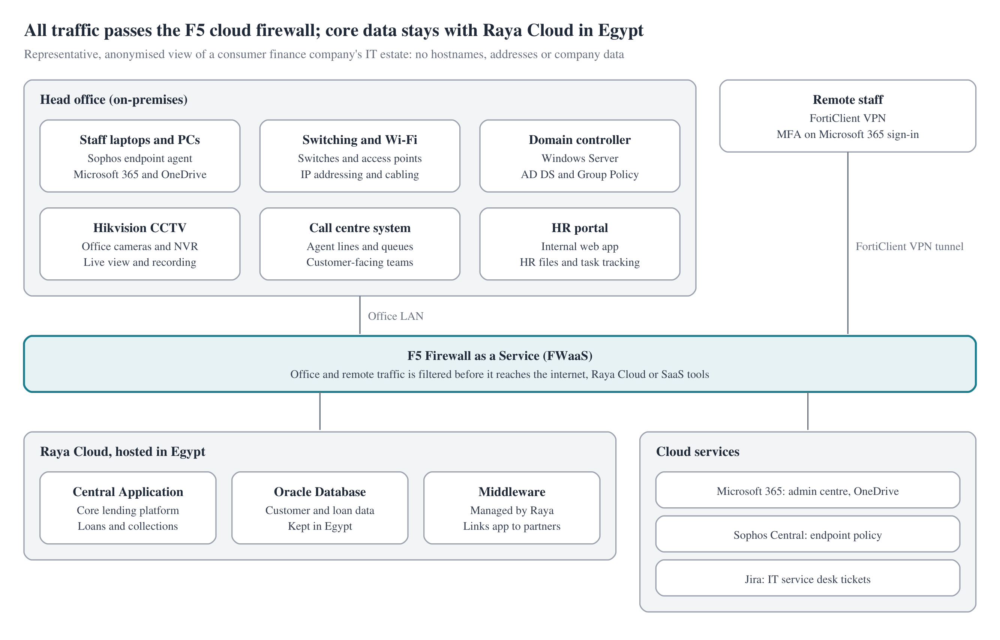
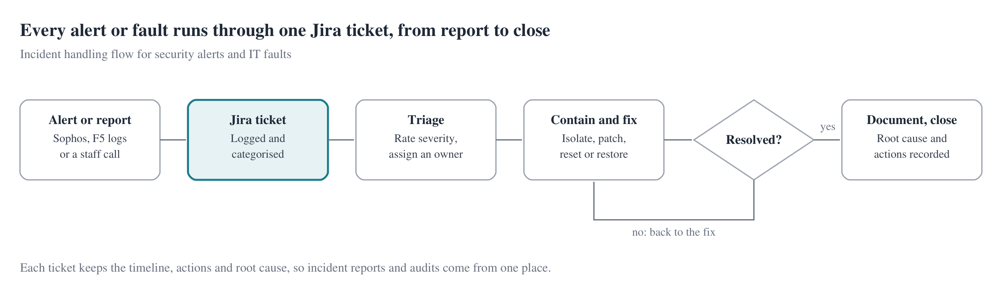
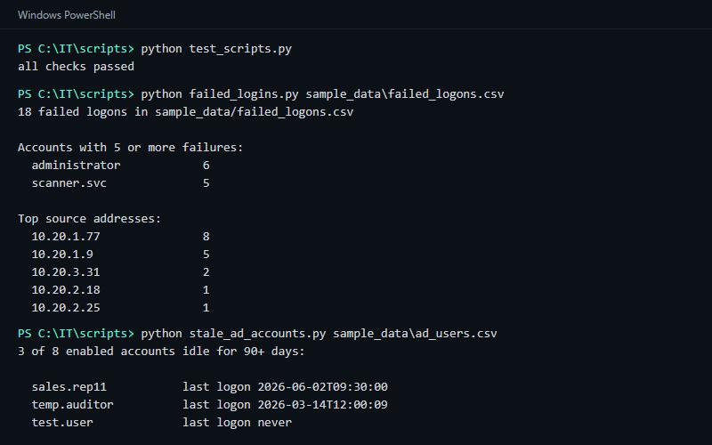
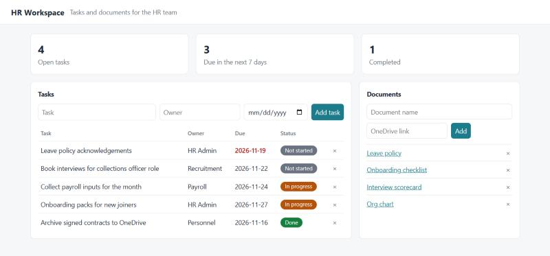

# IT systems and security portfolio

Work from my role as Systems Engineer at a consumer finance company in Egypt (June 2024 to present), rebuilt from scratch so it can be shared publicly. The employer is not named, and nothing here was taken from its systems. Sample data is synthetic.

What I run there: an F5 cloud firewall (FWaaS), FortiClient VPN for remote staff, Sophos endpoint protection, a Windows Server domain controller with Active Directory and Group Policy, Microsoft 365 and OneDrive administration, the office network, Hikvision CCTV, the call centre system, Jira IT ticketing, and day-to-day coordination with Raya Cloud, which hosts our Central Application, its Oracle database and the middleware.

## Architecture



Office and remote traffic goes through the F5 firewall before it reaches the internet, Raya Cloud or our SaaS tools. Core lending data stays in Raya's Egyptian data centres. Source: [diagrams/architecture.svg](diagrams/architecture.svg).

## FRA and PDPL compliance

I enforced FRA Board Resolution 227 of 2025 and FRA Decree 139 of 2023, and wrote the breach playbook for the PDPL Executive Regulations (Ministerial Decree 816 of 2025).

- [Compliance guide](compliance/README.md): what each rule asks for, who owns what in a company of around 50 staff, the steps in order, and a yearly evidence calendar.
- [Personal data breach playbook](compliance/pdpl-breach-playbook.md): the 72-hour PDPC clock, roles, containment steps and notice wording.

## Incident handling



Every security alert or IT fault gets one Jira ticket, from first report to closure, so the timeline and root cause are in one place when an audit or incident report needs them.

## Automation scripts



| Script | What it does |
| --- | --- |
| [failed_logins.py](scripts/failed_logins.py) | Summarises failed Windows logons (Event ID 4625) by account and source address and flags accounts at or above a threshold. Exits with code 1 when it finds any, so a scheduled task can raise an alert. |
| [stale_ad_accounts.py](scripts/stale_ad_accounts.py) | Lists enabled AD accounts with no logon in 90 days, for review with HR before they are disabled. |

Each script's docstring has the PowerShell export it reads. To run them on the sample data:

```
cd scripts
python test_scripts.py
python failed_logins.py sample_data/failed_logons.csv
python stale_ad_accounts.py sample_data/ad_users.csv
```

## HR portal



The HR team asked for one place to track their tasks and keep links to their documents. [hr-portal/index.html](hr-portal/index.html) is a single page with no build step and no server: open it in a browser. Tasks cycle through Not started, In progress and Done, overdue dates turn red, and document links point to OneDrive. Data is kept in the browser's local storage.

## Lab rebuild of the AD and GPO setup

[lab/build-ad-lab.ps1](lab/build-ad-lab.ps1) recreates the directory layout and policy baseline on a lab domain controller:

- an OU per department under Users, plus Computers, Groups and Service Accounts
- a global security group per department, and users from [lab/lab_users.csv](lab/lab_users.csv)
- domain password and lockout policy: 12 characters, complexity on, lockout after 5 failed attempts
- GPO `BL - Screen lock 10 min`, linked to Users
- GPO `BL - Workstation hardening` (LLMNR off, removable storage blocked), linked to Computers

Run it as Domain Admin on a Windows Server evaluation VM after `Install-ADDSForest`. It skips anything that already exists, so it is safe to run twice.

## Contact

Mohab Tarek, Systems Engineer, Cairo. [LinkedIn](https://www.linkedin.com/in/mohab-tarek-00585a2a4/)
